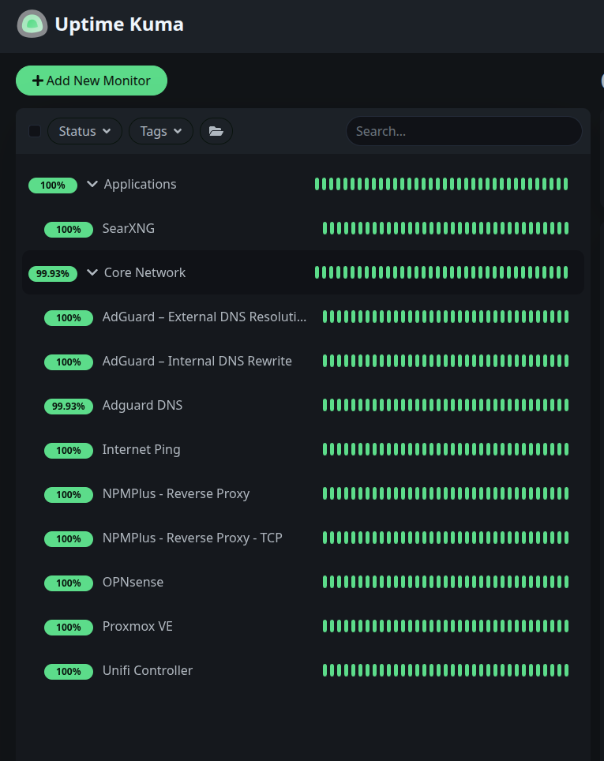
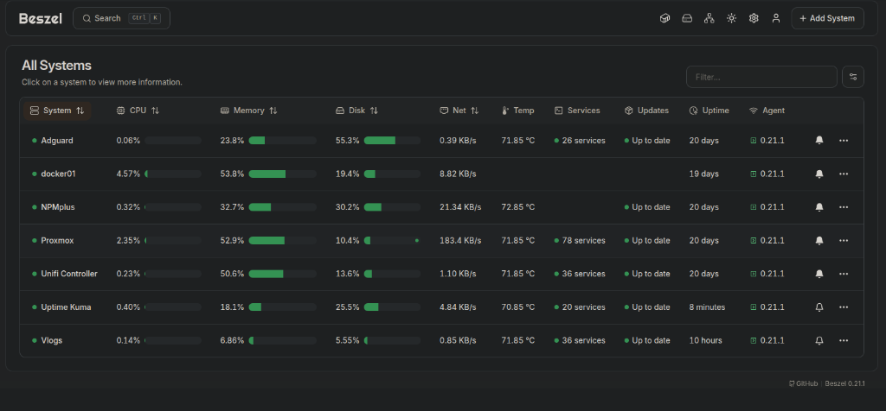

# Service and infrastructure monitoring

## Uptime Kuma

Uptime Kuma runs in a Servers-VLAN LXC and groups monitors into Applications and Core Network. The dashboard brings application reachability and infrastructure checks into one view.

## Monitored services

| Group | Monitor | Purpose |
| --- | --- | --- |
| Applications | SearXNG | Check access to the search application |
| Core Network | AdGuard — External DNS Resolution | Check resolution of an external name |
| Core Network | AdGuard — Internal DNS Rewrite | Check resolution of an internal service name |
| Core Network | AdGuard DNS | Check the DNS service |
| Core Network | Internet Ping | Check external connectivity |
| Core Network | NPMplus — Reverse Proxy | Check access through the reverse proxy |
| Core Network | NPMplus — Reverse Proxy — TCP | Check connectivity to the proxy's monitored TCP port |
| Core Network | OPNsense | Check firewall management-endpoint reachability |
| Core Network | Proxmox VE | Check host management-endpoint reachability |
| Core Network | UniFi Controller | Check controller reachability |

The separate DNS monitors distinguish upstream name resolution from local service-name rewrites. The reverse-proxy monitors separate the application-facing path from TCP connectivity. Management-endpoint checks cover the systems used to administer the lab.

## Following a failure

Start with the failed monitor's history, then follow the service's dependencies:

1. For DNS failures, compare the internal rewrite and external resolution checks. Follow the [DNS troubleshooting procedure](runbooks/dns-troubleshooting.md) through AdGuard, Unbound, and the upstream resolver.
2. For a proxied application failure, compare the reverse-proxy and TCP checks, then inspect the proxy-host configuration and backend service.
3. For management-endpoint failures, check the workload state in Proxmox, the network path, and the relevant firewall access rule.
4. After making a change, check the affected monitor and confirm access from the intended client network.

The dashboard displays recent check results and uptime percentages for each monitor. Monitor history helps locate when a failure began and whether related services were affected.

## Resource and SMART monitoring (Beszel)

Beszel complements Uptime Kuma's reachability checks with host and container resource history, systemd unit alerts, and physical disk health:

- The Beszel hub and local agent run in Docker Compose on Docker01 over a shared Unix socket.
- Native Beszel agents run on the Proxmox host and all infrastructure LXCs (UniFi Controller, AdGuard Home, VictoriaLogs, NPMplus, and Uptime Kuma) using hub-initiated SSH transport on a dedicated monitoring port.
- The Proxmox agent tracks both the root filesystem and the dedicated SATA backup SSD, plus NVMe and SATA SMART health via scoped capabilities and a narrow NVMe `udev` rule.

## Firewall log collection (VictoriaLogs + Vector)

A dedicated Servers-VLAN LXC runs Vector and VictoriaLogs for searchable OPNsense firewall history:

- OPNsense forwards `filterlog` and `firewall` events over TCP syslog (RFC 5424) to Vector.
- Vector parses each packet record into structured fields (`src_ip`, `dst_ip`, `protocol`, `src_port`, `dst_port`, `action`, `iface`, `direction`, `rule_label`) and writes JSON lines to VictoriaLogs over loopback.
- VictoriaLogs enforces both time-based (`7d`) and disk-usage (`80%`) retention limits, and its web UI is served internally behind NPMplus.

See [architecture](architecture.md), [network policy](network-and-security.md), and [DNS and HTTPS](dns-and-https.md).
