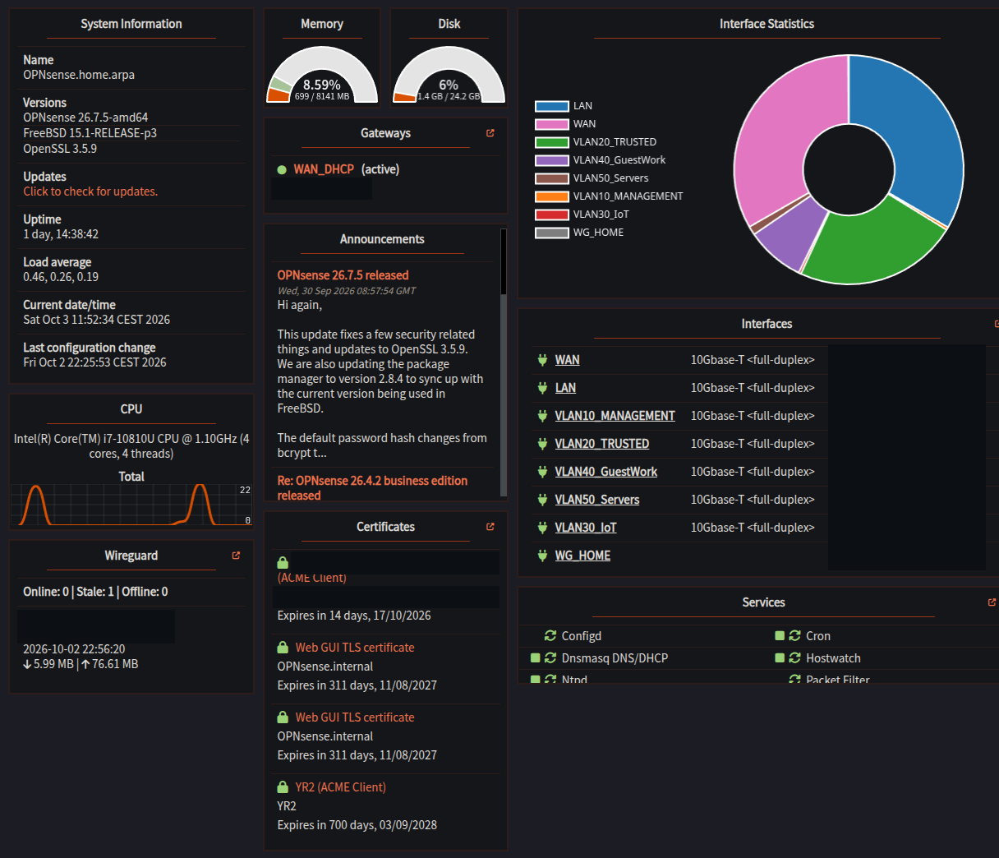
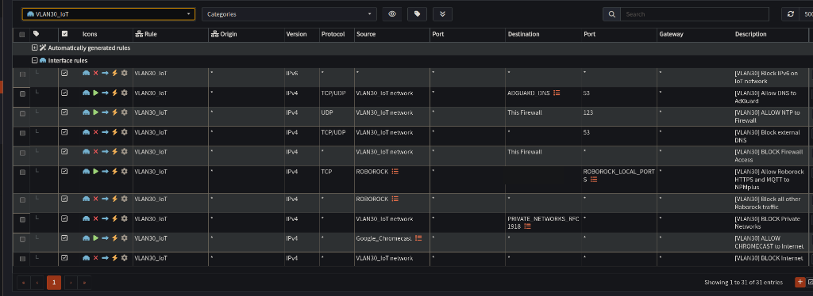
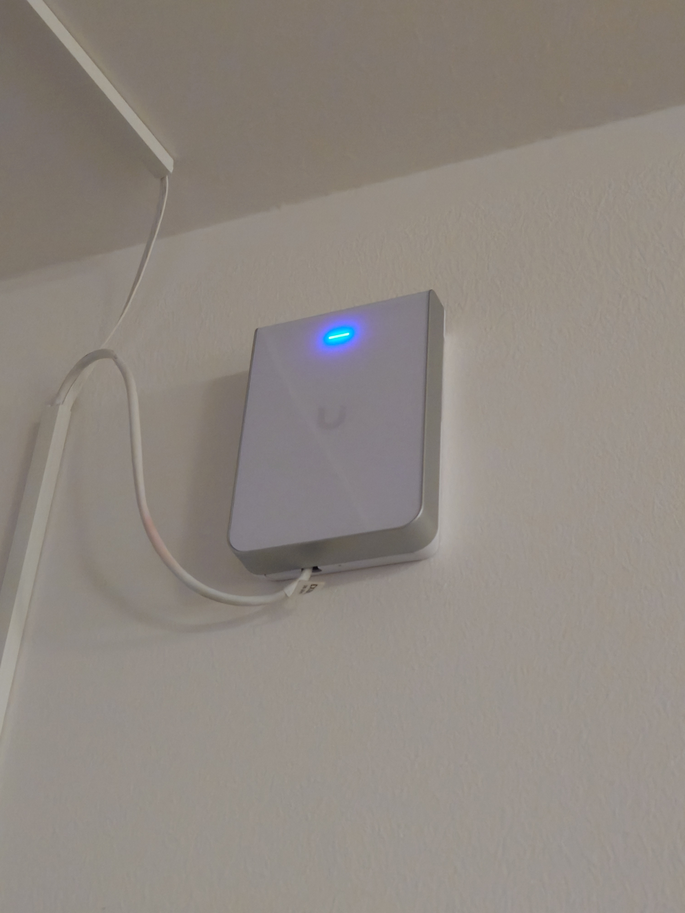
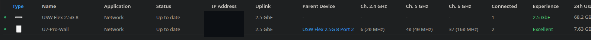
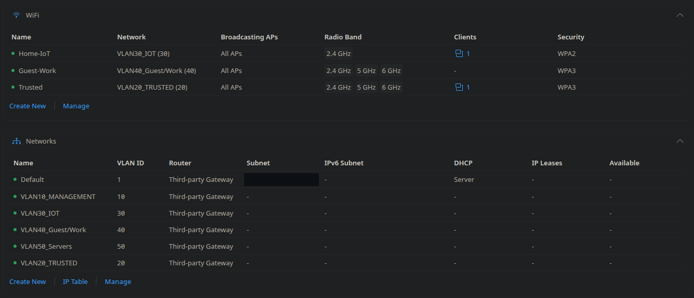
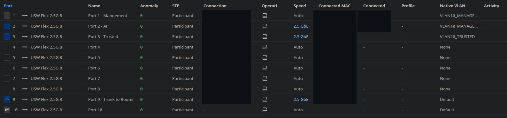
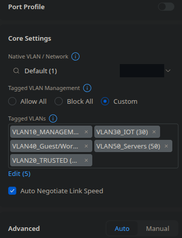

# Network segmentation and administrative security

## OPNsense platform

The OPNsense VM is the gateway for the internal VLANs and the WireGuard client network. It handles routing, firewall policy, DHCP, NTP, and the upstream DNS resolver used by AdGuard Home.

The dashboard brings gateway status, interface activity, system resources, and running services into one view. The interface names identify Management, Trusted, IoT, Guest/Work, Servers, and the home WireGuard tunnel.

## Routing policy

OPNsense routes between five internal VLANs. Internal addressing and policy are IPv4-only. The WAN uses DHCP, with IPv6 disabled. The unnumbered internal parent interface has its legacy default allow rules disabled.

The general interface-rule structure is:

1. Permit required internal services.
2. Block other restricted private-network destinations.
3. Permit remaining outbound internet traffic.

Key inter-network access rules:

| Source | Selected permitted internal access |
| --- | --- |
| Management | Firewall administration, infrastructure DNS/NTP, and NPMplus administration |
| Trusted clients | AdGuard DNS, internal HTTPS through NPMplus, and Roborock MQTT over TLS through NPMplus |
| Designated Trusted administrator workstation | Server-VLAN SSH, NPMplus administration, and broader access to selected management systems |
| IoT | AdGuard DNS, firewall NTP, and explicit per-device exceptions only (internet blocked by default) |
| Guest/Work | AdGuard DNS and firewall NTP |
| Servers | Required infrastructure services, with selected cross-VLAN monitoring exceptions (Uptime Kuma and Beszel) |
| WireGuard clients | AdGuard DNS and internal proxy HTTPS; other private destinations are restricted |

Uptime Kuma and Beszel have narrow cross-VLAN rules to reach monitored endpoints on the Management VLAN.

## WireGuard remote access

The Android phone imports its home WireGuard profile from the OPNsense peer-generator QR code. That profile is set as WG Tunnel's app-wide default, so auto-tunneling uses it on mobile data and Wi-Fi networks not listed as trusted. A matching trusted home Wi-Fi BSSID disables the tunnel.

The default-profile setting, automation options, and transition checks are documented in [Android VPN automation](android-vpn.md).

## IoT interface rules

The IoT VLAN blocks IPv6, internal networks, and outbound internet access by default, granting only explicit service and device exceptions:

| Action | Destination and purpose |
| --- | --- |
| Block IPv6 | Prevent IPv6 bypass on the IPv4-only IoT segment |
| Allow TCP/UDP 53 | AdGuard Home for DNS resolution |
| Allow UDP 123 | The firewall for time synchronization |
| Block TCP/UDP 53 | Other DNS destinations |
| Block | Other access to the firewall itself |
| Allow (Roborock only) | HTTPS (`443`) and MQTT TLS (`8883`) to NPMplus, followed by a logged block on all other Roborock traffic |
| Block | Other destinations in the private-network alias |
| Allow (selected devices) | Explicit outbound internet exceptions (such as a media streamer) |
| Block | Remaining outbound internet traffic |

The [cloud-free Roborock setup](cloud-free-roborock.md#vlan-and-firewall-policy) details the robot and Trusted client rules.

## UniFi switching and wireless

The UniFi Network controller runs in a Management-VLAN LXC. It manages a Flex 2.5G (`USW-Flex-2.5G-8`) switch and a U7-Pro-Wall access point. OPNsense remains responsible for routing, DHCP, and inter-VLAN firewall policy.

### Network hardware

| Component | Hardware | Connection and power |
| --- | --- | --- |
| Flex 2.5G switch | 8 x 2.5 GbE RJ45 ports; 10 GbE RJ45 / SFP+ combination uplink | Router trunk on port 9 at 2.5 GbE; USB-C or PoE+ power-input capability |
| U7 Pro Wall | Wi-Fi 7; 2.4, 5, and 6 GHz; 6 spatial streams; one 1/2.5 GbE Ethernet port | Wall-mounted; 2.5 GbE uplink from switch port 2 through a separate PoE injector |

The installed switch is the non-PoE-output model. It can receive PoE+ power, but does not supply PoE power to the AP. The AP's injector supplies its power separately from the switch's network connection.

Product references: [Flex 2.5G EU store](https://eu.store.ui.com/eu/en/products/usw-flex-2-5g-8), [Flex 2.5G specifications](https://techspecs.ui.com/unifi/switching/usw-flex-2-5g-8), [U7 Pro Wall EU store](https://eu.store.ui.com/eu/en/products/u7-pro-wall), and [U7 Pro Wall specifications](https://techspecs.ui.com/unifi/wifi/u7-pro-wall).

The AP provides the Trusted, IoT, and Guest/Work wireless networks. Its Ethernet uplink carries the corresponding VLAN traffic through the switch.

### Wireless networks

The access point connects to switch port 2 with a 2.5 GbE uplink. Wireless networks assign clients to the corresponding VLAN:

| Wi-Fi network | VLAN | Bands | Security |
| --- | ---: | --- | --- |
| Trusted | 20 | 2.4, 5, and 6 GHz | WPA3 |
| Home-IoT | 30 | 2.4 GHz | WPA2 |
| Guest-Work | 40 | 2.4, 5, and 6 GHz | WPA3 |

### Switch ports

Named switch ports identify the main wired connections:

| Port | Role | Native VLAN shown in UniFi |
| --- | --- | --- |
| 1 | Management connection | Management, VLAN 10 |
| 2 | Access point | Management, VLAN 10 |
| 3 | Trusted workstation connection | Trusted, VLAN 20 |
| 9 | Trunk to the router | Default, VLAN 1 |

Port names make the physical connections easy to identify during maintenance. The AP uplink, Trusted connection, and router trunk are displayed at 2.5 GbE.

### Router trunk — port 9

The router uplink uses individual port settings with an explicit tagged-VLAN list:

| Setting | Configuration |
| --- | --- |
| Native VLAN / Network | Default, VLAN 1 |
| Tagged VLAN Management | Custom |
| Tagged VLANs | 10 — Management; 20 — Trusted; 30 — IoT; 40 — Guest/Work; 50 — Servers |
| Auto Negotiate Link Speed | Enabled |
| Advanced mode | Auto |

Management, Trusted, IoT, Guest/Work, and Servers traffic crosses the trunk with its VLAN tags. Untagged traffic uses the native Default network. Selecting `Custom` limits tagged traffic to the five listed VLANs instead of allowing every tagged VLAN.

## Management-plane controls

| Platform | Routine identity and authentication | Additional control |
| --- | --- | --- |
| OPNsense | Named administrator; password-first TOTP | Built-in root account disabled; WebGUI bound to Management and Trusted |
| Proxmox VE | Named PAM account with TOTP for the WebGUI; SSH public keys for shell access | Management VLAN and separate direct-connect recovery path |
| NPMplus | Named administrator with two-factor authentication | Built-in Administrator account disabled; routed access to the administration port restricted |

NPMplus account settings manage application administrators. Proxmox, Docker01, and all Linux LXCs enforce SSH public-key authentication with root login and password authentication disabled (`PermitRootLogin no`, `PasswordAuthentication no`). Keep administrative SSH keys securely stored.

## Reverse-proxy access list

The `Internal Networks` list applies to internal proxy hosts behind NPMplus. It permits Management, Trusted, Servers, and WireGuard client networks, followed by denial of other source addresses. IoT and Guest/Work are not included (except for the dedicated Roborock HTTPS access list).

`Satisfy Any` and `Pass Auth to Upstream` are disabled. The list controls access to the proxy hosts by source address. OPNsense separately restricts routed access to the NPMplus administration panel.

NPMplus HTTP and HTTPS services are available internally, with no WAN port forwards for either service.

## Traffic paths and access controls

Inter-VLAN traffic passes through OPNsense. Devices in the same subnet communicate through the switch or virtual bridge. Access controls for these local connections belong at the application or workload level.

Keep account recovery material and backup archives private, and use the documented console or direct-connect procedures for recovery access.

For controlled changes, use the [firewall change procedure](runbooks/firewall-change.md).
